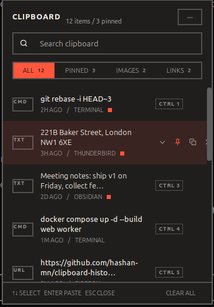

# Stash

**Stash** is a Super+V clipboard history panel for Ubuntu 24.04 / GNOME 46, built to the
"Modernist" design: Archivo, square corners, 2px rules, one red accent.

Keyboard first, dark by default. Remembers text, links, commands and images.

<p align="center">
  
</p>

---

## Why a shell extension and not an app

Mutter 46 implements no clipboard-monitor protocol: no `wlr-data-control`,
no `ext-data-control`. You can verify this on your own machine:

```
$ wl-paste --watch echo hi
Watch mode requires a compositor that supports the wlroots data-control protocol
```

A normal Wayland client can therefore only read the clipboard while it holds
focus, which makes a background history impossible. Three things this needs
are available only to code running inside `gnome-shell`:

| Capability | Shell API used |
|---|---|
| See every copy, system-wide | `global.display.get_selection()` → `owner-changed` |
| A real global hotkey (Wayland has no global grab) | `Main.wm.addKeybinding()` |
| Paste into the app you came from | window `activate()` + `Clutter` virtual keyboard |

---

## Install

```bash
tools/install.sh                     # symlink + compile the GSettings schema
tools/install-font.sh                # optional: Archivo, the design's typeface
gnome-extensions enable stash@hashan-mn.github.io
```

GNOME Shell only scans for extensions at startup, and Wayland cannot restart
the shell in place, so **log out and back in** after the first install.

To develop without logging out, use the nested shell. A crash there closes a
window instead of your session:

```bash
tools/dev-nested.sh                  # a second shell, in a window
tools/logs.sh                        # journal, filtered to this extension
```

## Uninstall

```bash
gnome-extensions disable stash@hashan-mn.github.io
rm -rf ~/.local/share/gnome-shell/extensions/stash@hashan-mn.github.io
rm -rf ~/.local/share/stash                  # the history itself
tools/install-font.sh --uninstall            # if you installed Archivo
```

---

## Keyboard

| Key | Action |
|---|---|
| `Super+V` | Open / close the panel |
| `↑` `↓` | Move through entries |
| `Enter` | Paste into the app you came from |
| `Ctrl+1…9` | Paste entry by number |
| `Tab` | Next category |
| `P` | Pin / unpin the selection |
| `Del` | Remove the selection |
| `/` | Jump to the search field |
| `Esc` | Close |

`P` and `Del` are suppressed while the search field has focus, so they can be
typed normally.

Right-click any entry for the full menu: paste, copy again, pin, paste as
plain text, delete.

---

## About the Super+V conflict

On a stock Ubuntu 24.04, `Super+V` is already bound to `toggle-message-tray`
(the default is `['<Super>v', '<Super>m']`). This extension takes it and
leaves `Super+M` for the tray.

The original value is saved into this extension's own GSettings before the
change, so it can be put back even if the shell exits without calling
`disable()`. Restoring by hand, if it ever comes to that:

```bash
gsettings set org.gnome.shell.keybindings toggle-message-tray "['<Super>v', '<Super>m']"
```

Pick a different shortcut in Preferences if you would rather keep Super+V on
the tray.

---

## Privacy

**History is stored unencrypted.** Entries live in
`~/.local/share/stash/` as plain JSON plus PNG files, readable by
any process running as you. That is inherent to clipboard managers, not
specific to this one, but it means every password or token you copy is
written to disk.

Two mitigations are on by default:

- **Password-manager hints.** Clips advertising `x-kde-passwordManagerHint`
  or `application/x-secret-service` are never recorded. KeePassXC, Secrets and
  most Wayland-native managers set these.
- **App blocklist.** Copies from KeePassXC, Bitwarden, 1Password and Secrets
  are ignored by window class. Editable in Preferences.

Turn off **Keep after reboot** for a memory-only history; pinned entries are
still kept, since pinning is an explicit "remember this".

Nothing is ever sent off the machine. There is no network code in this
extension.

---

## Recovery

A shell extension runs inside `gnome-shell`. On Wayland the shell cannot be
restarted, so a hard crash ends the session and closes open apps. It cannot
damage the OS: no root, no system files, everything under `~/.local`.

If the desktop becomes unusable, `Ctrl+Alt+F3` for a text console, then:

```bash
gnome-extensions disable stash@hashan-mn.github.io
```

`Ctrl+Alt+F1` (or F2) returns to the graphical session. If that is not enough,
reset the extension list entirely:

```bash
gsettings set org.gnome.shell enabled-extensions \
  "['ding@rastersoft.com', 'ubuntu-dock@ubuntu.com', 'tiling-assistant@ubuntu.com']"
```

"Ubuntu on Xorg" at the login screen gives a session where `Alt+F2` → `r`
restarts the shell live. A crashing extension cannot stop you logging in:
GNOME disables extensions that crash the shell during startup.

---

## Layout

```
stash@hashan-mn.github.io/
  extension.js          enable()/disable(), wiring only
  prefs.js              libadwaita preferences
  stylesheet.css        the design system
  src/
    monitor.js          Meta.Selection listener -> normalized clips
    store.js            dedupe, eviction, filtering
    persist.js          atomic JSON writes, image blobs, GC
    paster.js           focus restore + synthetic Ctrl+V
    keys.js             Super+V, and putting the tray binding back
    icons.js            the design's SVG paths, drawn with Cairo
    util.js             hashing, classification, formatting
    ui/panel.js         the 360x520 panel
    ui/row.js           one entry
    ui/menu.js          context menu + settings popover
```

Two notes for anyone editing the UI. St's CSS is a Clutter/Pango subset, not a
browser: there is no flexbox (layout comes from `St.BoxLayout`), no custom
properties (theme tokens are duplicated per class), and no `text-transform`
(strings are uppercased in JS). And `ClutterText` forces a single line as soon
as `ellipsize` is set, so two-line previews wrap with ellipsize *off* and the
ellipsis is added when the string is truncated.

---

## Compatibility

Built and verified against GNOME Shell 46 (Ubuntu 24.04) on Wayland.

Shell extensions break across GNOME major versions. Moving to 47/48 means
bumping `shell-version` in `metadata.json` and re-checking the APIs this
leans on: `Meta.Selection`, `St.ScrollView.set_child`, `Main.pushModal`, and
`Clutter.VirtualInputDevice`. `St.Align` was already removed in 46, so expect
similar churn.

---

## License

GPL-2.0-or-later, the same license as GNOME Shell. See [LICENSE](LICENSE).
